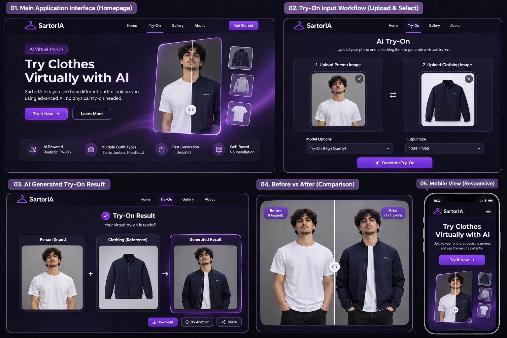
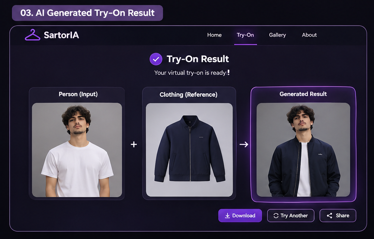
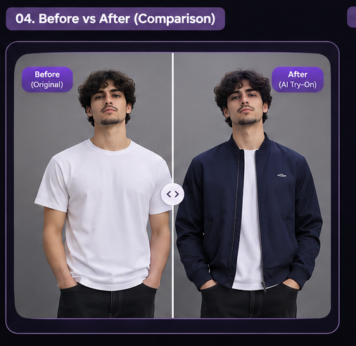
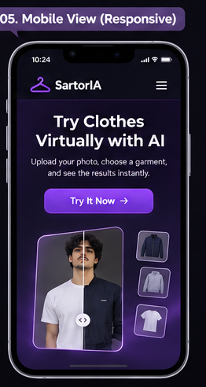
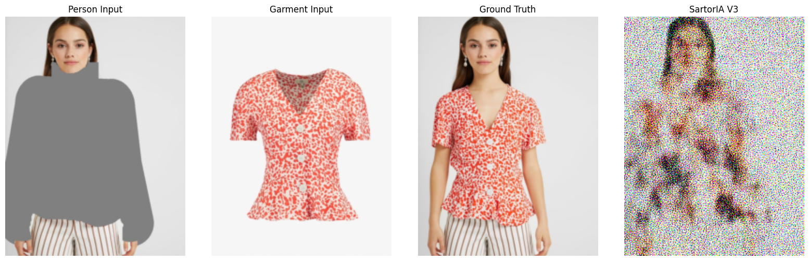
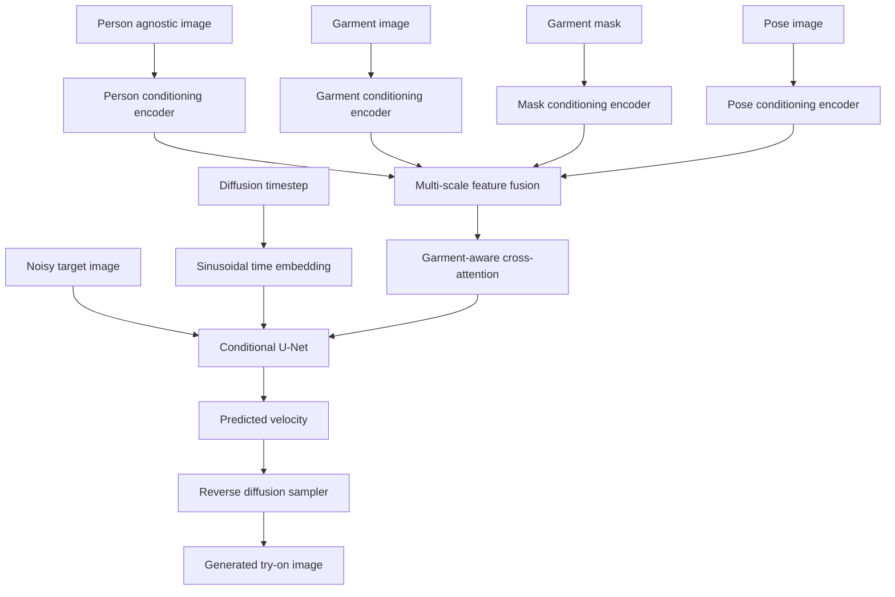
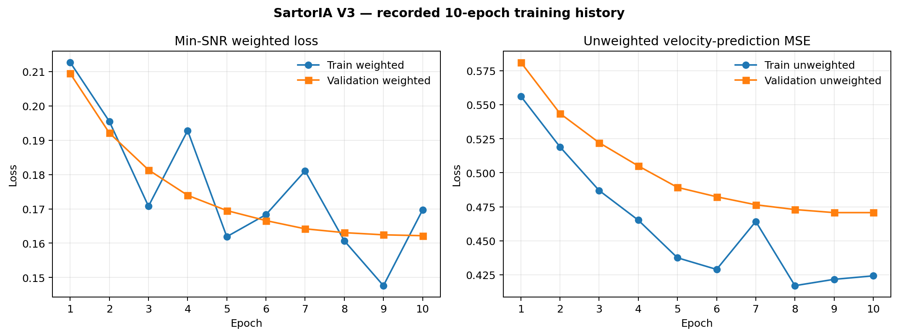
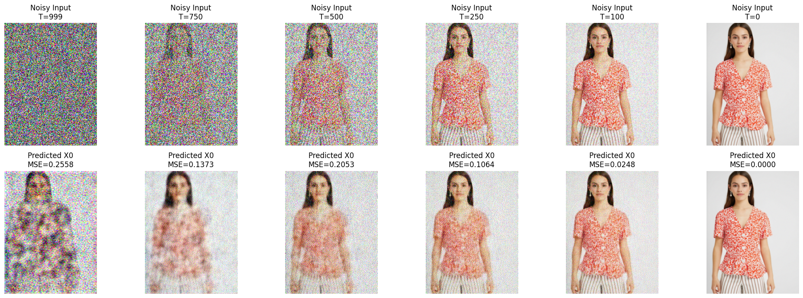

<div align="center">

# SartorIA 👗

### An Experimental AI Virtual Try-On Research Project

**Conditioning a diffusion U-Net on person context, garment appearance, garment masks, and pose information.**

[](https://www.python.org/)
[](https://pytorch.org/)
[](https://colab.research.google.com/)
[](LICENSE)
[](#current-project-status)

[Open the notebook](SartorIA.ipynb) · [Open in Colab](https://colab.research.google.com/github/MuhammadAhmedSubhani/SartorIA/blob/main/SartorIA.ipynb)

</div>

---

> **Project status — experimental:** The current repository is primarily a Google Colab/PyTorch research notebook. It does not yet contain a deployable web application or a production-ready virtual try-on system. The notebook records model development, training, checkpointing, inference, and diagnostics. The generated V3 sample is still noisy and needs substantial improvement.

## Contents

- [Overview](#overview)
- [Visual progress](#visual-progress)
- [Model development](#model-development)
- [SartorIA V3 architecture](#sartoria-v3-architecture)
- [Dataset and preprocessing](#dataset-and-preprocessing)
- [Training configuration and results](#training-configuration-and-results)
- [Inference and diagnostics](#inference-and-diagnostics)
- [Repository structure](#repository-structure)
- [Run the notebook](#run-the-notebook)
- [Limitations and next steps](#limitations-and-next-steps)
- [Dataset and code licensing](#dataset-and-code-licensing)

## Overview

SartorIA explores an AI-assisted virtual try-on workflow: given a person image and a garment image, the model is trained to generate an image in which the person appears wearing the selected clothing item.

The research notebook evolved through three iterations:

1. **VESTA V1** — an initial conditional diffusion U-Net with separate conditioning encoders and a linear noise schedule.
2. **VESTA V2** — retained the core U-Net and introduced a cosine diffusion schedule and velocity (`v`) prediction after earlier generation diagnostics.
3. **SartorIA V3** — added garment-aware cross-attention at three feature scales, while retaining person, garment, mask, and pose conditioning.

The V3 model is initialized with fresh weights in the notebook; no pretrained virtual try-on checkpoint is loaded for this V3 training run.

## Visual progress

### UI direction — illustrative concepts

The following images are **AI-generated interface concepts** created to communicate a possible product direction. They are not screenshots of a working SartorIA frontend, and the depicted buttons, gallery, mobile layout, or download/share interactions should not be interpreted as implemented features.

<div align="center">
  
  <p><em>Concept board: homepage, input workflow, illustrative result view, comparison layout, and mobile layout.</em></p>
</div>

<details>
<summary>View individual UI concepts</summary>

<div align="center">
  
  <p><em>Homepage concept — illustrative only.</em></p>
  
  <p><em>Person and garment input concept — illustrative only.</em></p>
  
  <p><em>Result screen concept — not an actual V3 model output.</em></p>
  
  <p><em>Comparison layout concept — illustrative only.</em></p>
  
  <p><em>Mobile layout concept — illustrative only.</em></p>
</div>

</details>

### Actual notebook output — SartorIA V3

This figure is taken from the notebook's V3 inference cell. It shows the person input, garment input, ground-truth target, and the first reverse-diffusion output. The current generated output is visibly noisy and is included to document the real experimental state, not to claim production-quality try-on results.

<div align="center">
  
</div>

## Model development

| Iteration | Main change | Notebook status |
|---|---|---|
| VESTA V1 | Conditional diffusion U-Net, separate conditioning encoders, linear noise schedule, noise prediction | Implemented and trained in earlier notebook phases |
| VESTA V2 | Cosine scheduler and velocity prediction; V2 checkpoint and reverse-diffusion sampler | Implemented, trained, and restored from checkpoint |
| SartorIA V3 | Garment-aware cross-attention at three scales, identity-preserving residual integration, V3-specific training loop | Implemented and trained for 10 epochs; inference quality remains experimental |

## SartorIA V3 architecture

V3 uses a conditional diffusion U-Net. The person representation acts as the **query** for cross-attention, while pooled garment features provide the **keys** and **values**. The attended garment information is integrated into person features through a residual connection.

### Conditioning inputs

| Input | Notebook tensor channels | Role |
|---|---:|---|
| Noisy target image | 3 | Image state being denoised by the diffusion model |
| Agnostic person image | 3 | Person and body context with the original clothing region removed/agnostic |
| Garment image | 3 | Appearance and texture of the target clothing item |
| Garment mask | 1 | Garment silhouette conditioning |
| Pose image | 3 | Spatial pose representation supplied by the dataset |
| Timestep | Embedded to 128 dimensions | Indicates the current diffusion step |

> The dataset garment mask is a **garment-product mask**. It is not a segmentation mask of the person's clothing region. The notebook keeps these inputs separate rather than treating the mask types as interchangeable.

### Processing flow



### Cross-attention design

- **Attention heads:** 4.
- **Garment token grid:** adaptive average pooling to 8 × 6 (48 garment tokens).
- **Feature scales:** three resolutions, tested at 128 × 96, 64 × 48, and 32 × 24.
- **Feature channels:** 32, 64, and 128 across those scales.
- **Residual behavior:** the attention output projection is zero-initialized; the module returns the original person features plus a learned, scaled attention contribution.
- **U-Net base width:** 32 channels.
- **Timestep embedding:** 128 dimensions.
- **Trainable parameters:** 2,475,462.
- **Output tensor:** 3-channel image at 256 × 192.

The V3 model and its forward pass, tensor dimensions, numerical finiteness, and attention gradient flow are checked in the notebook before the full training loop.

## Dataset and preprocessing

The notebook streams a subset of the **VITON-HD** dataset from the Hugging Face repository [`forgeml/viton_hd`](https://huggingface.co/datasets/forgeml/viton_hd).

| Item | Value recorded in the notebook |
|---|---|
| Samples acquired | 500 pairs |
| Acquisition seed | 42 |
| Streaming shuffle buffer | 1,000 |
| Successful records | 500 |
| Failed records | 0 |
| Training split | 450 samples (90%) |
| Validation split | 50 samples (10%) |
| Split seed | 42 |
| Original image dimensions reported | 768 × 1,024 |
| Model input size | 256 × 192 (height × width) |
| DataLoader batch size | 1 |

Each sample is assembled from the notebook's `image`, `cloth`, `agnostic`, `cloth_mask`, and `pose` fields, stored in the processed dataset as:

- `target` — original person image;
- `garment` — clothing item image;
- `agnostic` — person context image;
- `cloth_mask` — garment mask;
- `pose` — pose representation.

RGB inputs are resized with bilinear interpolation and normalized to `[-1, 1]`. The mask is resized with nearest-neighbor interpolation. The split and file manifests are saved to Google Drive by the notebook.

## Training configuration and results

SartorIA V3's recorded training configuration:

| Setting | Value |
|---|---:|
| Optimizer | AdamW |
| Initial learning rate | 0.0001 |
| Weight decay | 0.0001 |
| Epochs | 10 |
| Batch size | 1 |
| Gradient accumulation | 4 steps |
| Gradient clipping | 1.0 maximum gradient norm |
| Diffusion timesteps | 1,000 |
| Objective | Velocity (`v`) prediction |
| Min-SNR gamma | 5.0 |
| LR scheduler | Cosine annealing, minimum LR 0.000001 |
| Mixed precision | Enabled when CUDA is available |

### Recorded epoch history

The following values are copied from the V3 training output in the notebook. Weighted loss is the Min-SNR-weighted velocity-prediction loss used for optimization; unweighted loss is the corresponding unweighted velocity-prediction MSE. These are training diagnostics, **not** FID, LPIPS, or a direct measure of visual garment-transfer quality.

| Epoch | Train weighted | Val weighted | Train unweighted | Val unweighted |
|---:|---:|---:|---:|---:|
| 1 | 0.212738 | 0.209496 | 0.556316 | 0.581264 |
| 2 | 0.195511 | 0.192142 | 0.519046 | 0.543632 |
| 3 | 0.170771 | 0.181367 | 0.486978 | 0.522134 |
| 4 | 0.192828 | 0.173957 | 0.465161 | 0.505037 |
| 5 | 0.161895 | 0.169508 | 0.437492 | 0.489269 |
| 6 | 0.168317 | 0.166583 | 0.428928 | 0.482364 |
| 7 | 0.181068 | 0.164190 | 0.464203 | 0.476478 |
| 8 | 0.160712 | 0.163070 | 0.416981 | 0.472959 |
| 9 | 0.147615 | 0.162440 | 0.421638 | 0.470701 |
| 10 | 0.169692 | **0.162182** | 0.424183 | 0.470702 |

<div align="center">
  
  <p><em>V3 training curves reconstructed from the per-epoch metrics recorded in the notebook.</em></p>
</div>

**Best recorded V3 checkpoint:** epoch 10, validation weighted loss **0.162182**. The notebook saves latest, best, and per-epoch checkpoints to the Google Drive project directory.

## Inference and diagnostics

The notebook restores the best V3 checkpoint and runs a 1,000-step reverse-diffusion sampler on a validation sample. The returned tensor has shape `[1, 3, 256, 192]`; the notebook reports no NaN or Inf values. This confirms numerical finiteness, but does not establish that the generated image is visually satisfactory.

### Controlled denoising diagnostic

A separate diagnostic adds fixed noise to a known target image at selected timesteps, asks V3 to predict velocity, and reconstructs a predicted clean image (`x0`). The notebook reports:

| Timestep | Reconstruction MSE |
|---:|---:|
| 999 | 0.25576 |
| 750 | 0.13732 |
| 500 | 0.20533 |
| 250 | 0.10642 |
| 100 | 0.02482 |
| 0 | 0.00005 |

<div align="center">
  
  <p><em>Notebook diagnostic: noisy target inputs and reconstructed x0 predictions across timesteps.</em></p>
</div>

**Interpretation:** this is a controlled reconstruction diagnostic using the ground-truth target as the starting image. It is not the same as generating a try-on image from random noise. In particular, the near-zero error at timestep 0 is expected because the input is almost the clean target at that timestep; it should not be presented as evidence of successful end-to-end try-on generation.

## Repository structure

The repository currently contains the notebook, documentation, license, and visual assets. Model checkpoints, processed dataset files, training history, and generated outputs are written by the notebook to Google Drive; they are not currently committed as source files in this repository.

```text
SartorIA/
├── .gitignore
├── LICENSE
├── README.md
├── SartorIA.ipynb
└── assets/
    └── progress/
        ├── 01-current-interface.png       # AI-generated UI concept
        ├── 02-try-on-workflow.png         # AI-generated UI concept
        ├── 03-generated-result.png        # AI-generated UI concept
        ├── 04-before-after.png            # AI-generated UI concept
        ├── 05-mobile-view.png             # AI-generated UI concept
        ├── SartorIA-concept-board.png     # AI-generated UI concept board
        ├── 06-v3-first-inference.png      # Actual notebook output
        ├── 07-v3-denoising-diagnostic.png # Actual notebook diagnostic
        └── 08-v3-training-history.png     # Plot from recorded V3 metrics
```

The notebook uses a Google Drive workspace named `VESTA_AI`, with data, source, model, checkpoint, and output directories created during notebook execution. Those runtime directories are not the same as the committed GitHub tree above.

## Run the notebook

1. Open [`SartorIA.ipynb`](SartorIA.ipynb) in Google Colab, or use the **Open in Colab** link at the top of this README.
2. Select a GPU runtime for practical training and inference. The recorded recovery session reports an NVIDIA Tesla T4.
3. Run the notebook cells in order and authorize Google Drive when prompted. The notebook expects its workspace under `MyDrive/VESTA_AI`.
4. The acquisition phase loads the `forgeml/viton_hd` dataset through Hugging Face Datasets and creates the 500-sample processed subset. The notebook saves the manifests and processed files to Drive.
5. Continue through model definition, training, checkpointing, inference, and diagnostics. For an interrupted session with saved artifacts, use the notebook's **Recovery Phase R1–R7** rather than downloading and processing the same 500 records again.

The notebook installs/imports packages including PyTorch, Torchvision, NumPy, Pandas, Pillow, Matplotlib, tqdm, OpenCV, einops, scikit-learn, safetensors, Hugging Face Hub, and Datasets. The notebook contains the installation cells; use the versions compatible with the active Colab runtime.

## Limitations and next steps

- The current repository is notebook-centric; there is no application frontend, API service, or deployment configuration in the committed tree.
- The processed training subset contains 500 samples, which is small for a high-quality image-generation task.
- The first V3 reverse-diffusion result is visibly noisy and does not yet demonstrate reliable garment transfer.
- Loss reduction alone does not prove visual realism, identity preservation, garment fidelity, or correct body alignment.
- The notebook does not report a dedicated quantitative VTON benchmark (for example, FID, LPIPS, or a garment-alignment metric).
- The dataset repository's Hugging Face API response in the notebook did not expose a license value. The notebook's own metadata records the original VITON-HD license status as **CC BY-NC 4.0 / research use only**. Verify the upstream dataset terms before redistribution or any commercial use.

### Next development priorities

1. Improve the reverse-diffusion output and inspect whether garment conditioning is being used effectively.
2. Evaluate identity preservation, garment fidelity, and alignment on a larger held-out set.
3. Add repeatable quantitative evaluation and save model comparisons for V1, V2, and V3.
4. Move reusable model, data, training, and inference code out of the notebook into importable Python modules.
5. Build a frontend/API only after the inference pipeline has stable, demonstrable results.

## Dataset and code licensing

- **Repository code:** MIT License — see [LICENSE](LICENSE).
- **Dataset:** the notebook records VITON-HD's original license as **CC BY-NC 4.0 (non-commercial)**, while the Hugging Face metadata query returned no license field. Review the original dataset terms and attribution requirements before sharing data or using it commercially. The dataset itself is not included in this repository.

## Author

**Muhammad Ahmed Subhani**  
[GitHub Profile](https://github.com/MuhammadAhmedSubhani) · [SartorIA Repository](https://github.com/MuhammadAhmedSubhani/SartorIA)

---

<div align="center">
  <em>SartorIA — research toward more useful AI-assisted fashion visualization.</em>
</div>
