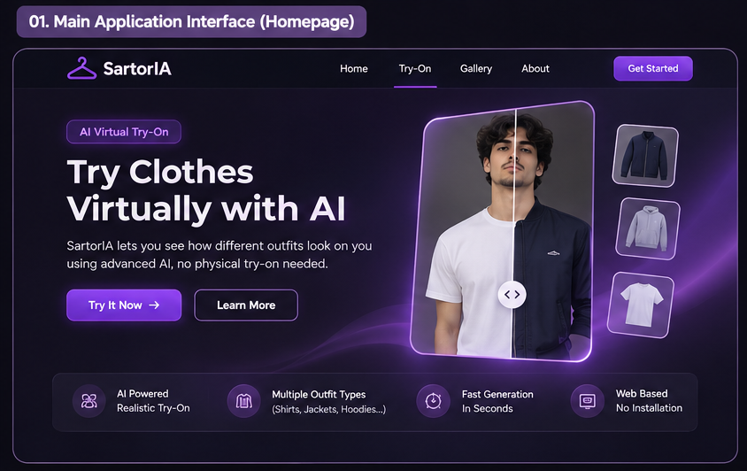
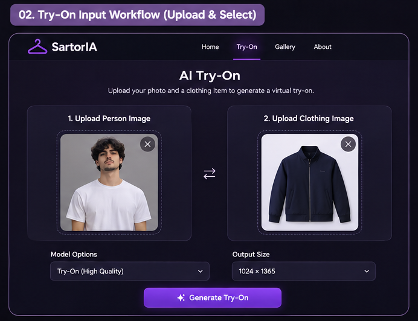

# SartorIA 👗

**AI-powered virtual try-on — preview how clothing may look on you before making a purchase.**

SartorIA is a work-in-progress virtual try-on project exploring how AI can make online fashion shopping more visual and engaging. The goal is to let users preview a garment on a person image and get a better idea of its overall appearance before deciding whether to buy it.

> **Project status:** In active development. This repository is being built out, so features, implementation details, and setup instructions will be updated as the project progresses.

## ✨ Project Overview

Online shoppers often have to imagine how an item of clothing might look when worn. SartorIA aims to make that experience more intuitive through an AI-assisted virtual try-on workflow.

The intended experience is:

1. **Choose a person image** — provide the image that will be used for the try-on.
2. **Choose a garment** — provide or select the clothing item to preview.
3. **Generate a preview** — process the inputs to create a virtual try-on result.
4. **Review the result** — inspect the generated image and compare the visual appearance.

These steps describe the project's intended workflow; individual capabilities should be considered complete only when they are implemented in the application.

## 🖼️ Development Progress

Screenshots will be added here as the interface and try-on pipeline evolve. Add your project images to `assets/progress/` using the filenames below, or update the paths to match your own filenames.

### 1. Current Interface



*Current application interface — replace this image with a screenshot of the latest build.*

### 2. Try-On Workflow



*Person image and garment selection / processing workflow — add a screenshot when this stage is available.*

### 3. Generated Try-On Preview


*Example output from the virtual try-on pipeline — add a real project result when available.*

## 🎯 Project Goals

- Build an intuitive virtual try-on experience.
- Explore AI-based clothing visualization.
- Make it easier to preview the appearance of garments before purchase.
- Improve the quality and consistency of generated try-on results.
- Keep the project modular and document its development over time.

## 🧰 Technology & Implementation

The repository's implementation stack and model details have not yet been documented. This section will be updated with the actual frameworks, libraries, AI models, and tools used as the application code is added to the repository. No specific model or framework is claimed here until it is confirmed by the source code.

## 📊 Development Roadmap

| Area | Status |
|---|---|
| Project concept and repository setup | Started |
| User interface | Under development; screenshots not yet added |
| Person image input | To be confirmed |
| Garment image input | To be confirmed |
| AI try-on generation | To be confirmed |
| Result preview and comparison | To be confirmed |
| Setup and usage documentation | To be added |

Update these statuses as each part is implemented.

## 🗂️ Dataset & Directory Structure

No dataset details or dataset files are currently documented in this repository. When a dataset is selected or added, this section should identify its name, source, license, relevant annotations, preprocessing steps, and train/validation/test split (if applicable).

For progress screenshots, the following is a suggested folder layout. It is a documentation layout, not a claim about the current source-code structure:

```text
SartorIA/
├── assets/
│   └── progress/
│       ├── 01-current-interface.png
│       ├── 02-try-on-workflow.png
│       └── 03-try-on-result.png
├── .gitignore
├── LICENSE
└── README.md
```

As the application grows, extend this tree to reflect the real folders and files in the repository. Avoid committing private, sensitive, or unlicensed person and garment images. Check the terms of use before redistributing any dataset.

## 🚀 Getting Started

Run instructions will be provided once the application source code and dependency files are available in this repository. In the meantime, check back for development updates and screenshots.

## ⚠️ Disclaimer

Virtual try-on images are visual previews and may not represent exact garment sizing, fabric behavior, body measurements, or real-world fit. Generated results can vary depending on the input images and the underlying model.

## 📄 License

This project is released under the [MIT License](LICENSE).

## 👨‍💻 Author

**Muhammad Ahmed Subhani**  
[GitHub Profile](https://github.com/MuhammadAhmedSubhani)

---

*SartorIA — bringing a more visual experience to online fashion.*
